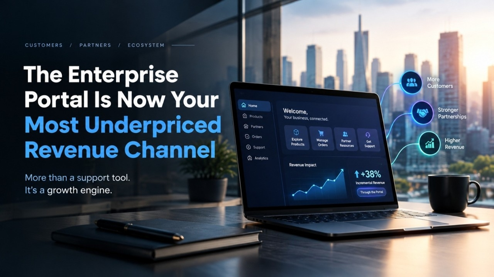

# The Enterprise Portal Is Now Your Most Underpriced Revenue Channel

Enterprise portals are often treated as support tools. But for businesses looking to strengthen customer relationships, improve retention, and create new revenue opportunities, they can play a much bigger strategic role. **[Digital Workplace Portal Development](https://zignuts.com/blog/enterprise-portal-development-services-guide?utm_source=seo_web2.0&utm_medium=backlink&utm_campaign=seo_referral&utm_id=10)** can help organizations create connected digital experiences that support both operational efficiency and business growth.

## Why Enterprise Portals Deserve Executive Attention

A well-designed portal can bring together customer interactions, product information, order management, service requests, and account insights in one digital experience.

For founders and C-suite leaders, the opportunity is to connect this experience to measurable business objectives.

## From Customer Support to Revenue Enablement

An enterprise portal can help businesses:

- Identify opportunities for cross-selling and upselling.
- Improve customer retention through easier self-service.
- Reduce friction in purchasing and account management.
- Strengthen partner engagement.
- Use customer activity to inform business decisions.

## What Business Leaders Should Evaluate

Before investing in a portal, consider customer adoption, integration with existing systems, operational costs, conversion rates, and the potential for recurring revenue.

The objective is not simply to launch another digital platform. It is to create a useful business channel that supports customer value and sustainable growth.

## Final Thoughts

Enterprise portals deserve attention as part of a broader digital growth strategy. When aligned with customer needs and business goals, they can become more than a service interface. They can become an important part of how a company grows.
